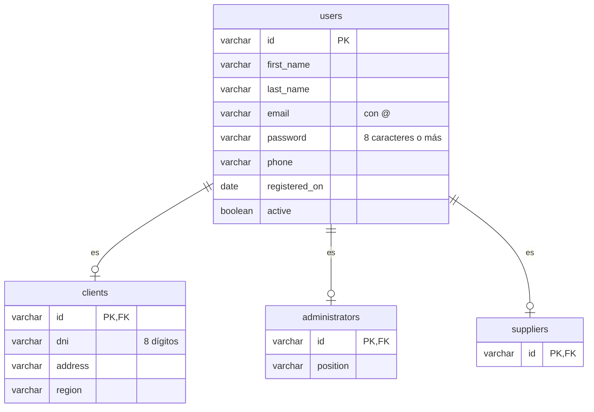
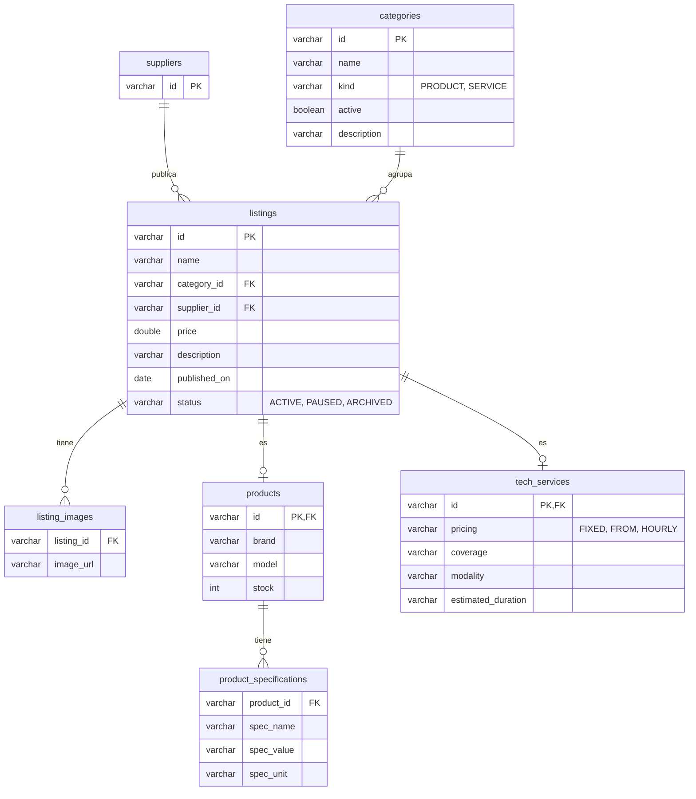
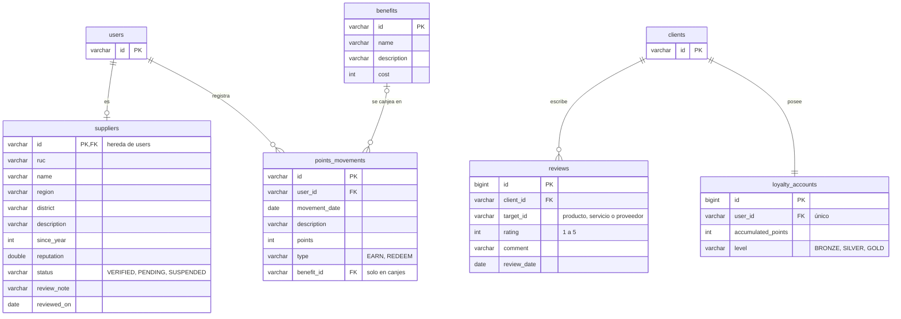
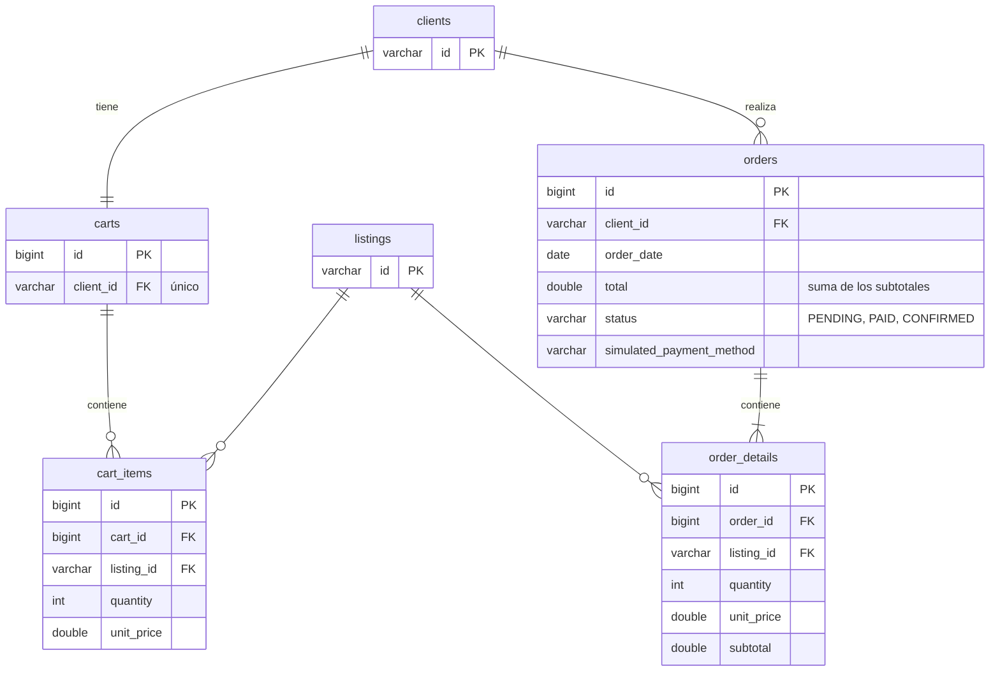
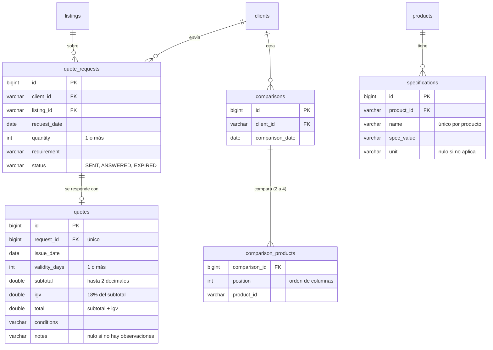

# Modelo de datos

Tablas de cada módulo de `apps/api`. Todos los módulos persisten en **MySQL con Spring Data JPA**, con las piezas
del profesor en `infrastructure/persistence/jpa/`: `entities/` (`...JpaEntity`), `repositories/`
(`...JpaRepository`), `mappers/` (`...PersistenceMapper`) y `adapters/` (`...RepositoryAdapter`, que implementa el
repositorio del dominio). Las tablas las crea Hibernate (`spring.jpa.hibernate.ddl-auto=update`).

Las entidades del diagrama de clases del equipo están en español; en el código y en las tablas van en inglés (ver
[`responsabilidades.md`](responsabilidades.md)). En cada diagrama, las tablas de otros módulos solo muestran las
columnas que se referencian.

## Usuarios y acceso (`iam`, Benjamin)

`User` es abstracta y usa herencia `JOINED`: cada subclase tiene su tabla, cuya clave es también la clave de
`users`. `Supplier` (módulo `suppliers`) también hereda de `User`.

| Clase (dominio) | Tipo | Tabla | Persistencia |
|---|---|---|---|
| `User` | Aggregate abstracto | `users` | — |
| `Client` | Hereda de `User` | `users` + `clients` | `ClientRepositoryAdapter` |
| `Administrator` | Hereda de `User` | `users` + `administrators` | `AdministratorRepositoryAdapter` |

## Catálogo (`catalog`, Carlos)

`Listing` (publicación) es abstracta y usa herencia `JOINED`: `products` y `tech_services` comparten la clave de
`listings`. La entidad se llama `TechService` porque `Service` choca con la anotación `@Service` de Spring.

| Clase (dominio) | Tipo | Tabla | Persistencia |
|---|---|---|---|
| `Listing` | Aggregate abstracto | `listings` + `listing_images` | — |
| `Product` | Hereda de `Listing` | `listings` + `products` + `product_specifications` | `ProductRepositoryAdapter` |
| `TechService` | Hereda de `Listing` | `listings` + `tech_services` | `TechServiceRepositoryAdapter` |
| `Category` | Aggregate | `categories` | `CategoryRepositoryAdapter` |

## Proveedor, reseñas y fidelización (`suppliers`, `reviews` y `loyalty`, Esperanza)

`verified` del proveedor no se guarda: es `true` solo si `status = VERIFIED`. El saldo de puntos sale de los
movimientos: `EARN` suma y `REDEEM` resta.

| Clase (dominio) | Tipo | Tabla | Persistencia |
|---|---|---|---|
| `Supplier` | Hereda de `User` | `users` + `suppliers` | `SupplierRepositoryAdapter` |
| `Review` | Aggregate | `reviews` | `ReviewRepositoryAdapter` |
| `LoyaltyAccount` | Aggregate | `loyalty_accounts` | `LoyaltyAccountRepositoryAdapter` |
| `PointsMovement` | Aggregate | `points_movements` | `PointsMovementRepositoryAdapter` |
| `Benefit` | Aggregate | `benefits` | `BenefitRepositoryAdapter` |

## Compra simulada (`orders`, Leyla)

Cada cliente tiene un solo carrito. Al comprar, cada ítem del carrito pasa a ser un detalle del pedido con el
precio de ese momento. El pago es simulado: no hay pasarela.

| Clase (dominio) | Tipo | Tabla | Persistencia |
|---|---|---|---|
| `Cart` | Aggregate | `carts` | `CartRepositoryAdapter` |
| `CartItem` | Entity dentro del carrito | `cart_items` | Se guarda con su carrito (`cascade`) |
| `Order` | Aggregate | `orders` | `OrderRepositoryAdapter` |
| `OrderDetail` | Entity dentro del pedido | `order_details` | Se guarda con su pedido (`cascade`) |

## Cotizaciones y comparador (`quotes`, Esteban)

| Clase (dominio) | Tipo | Tabla | Persistencia |
|---|---|---|---|
| `QuoteRequest` | Aggregate | `quote_requests` | `QuoteRequestRepositoryAdapter` |
| `Quote` | Entity dentro de la solicitud | `quotes` | Se guarda con su solicitud (`cascade`) |
| `QuoteAmounts` | Value object de `Quote` | Columnas `subtotal`, `igv` y `total` de `quotes` | Lo arma `QuoteRequestPersistenceMapper` |
| `Specification` | Aggregate | `specifications` | `SpecificationRepositoryAdapter` |
| `Comparison` | Aggregate | `comparisons` + `comparison_products` | `ComparisonRepositoryAdapter` |
